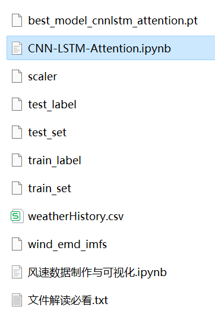
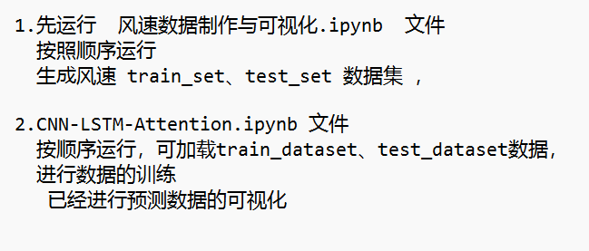

# Multi-feature Variable Sequence Prediction (II) CNN-LSTM-Attention Wind Speed Forecasting Model

Single-variable includes the following content:  
CNN-LSTM-Attention model, with smaller MSE and MAE, showing particularly significant results.  
Includes code for data preprocessing and complete CNN-LSTM-Attention model prediction and visualization code.  
Environment: Python 3.9  
Preface  
\tThis article introduces a multi-feature variable sequence prediction model CNN-LSTM-Attention based on the wind speed data (attached at the end of this document) to improve the predictive performance of time series data. The dataset consists of nine variables including weather, temperature, humidity, pressure, and wind speed. By creating datasets using sliding windows, we use multiple variables to predict wind speed.  
\t  
\tThe LSTF (Long Sequence Time-Series Forecasting) problem refers to the need to handle long sequences in time series forecasting. In practical applications, time series may contain a very large number of data points. In such cases, traditional time series forecasting models may encounter some challenges due to issues when processing long sequences, such as:  
\tLong-term dependency: As the time series data grows, the model needs to be able to capture long-term dependencies and trends.  
\tComputational complexity: Training and predicting on long sequences typically require more computational resources and time.  
\tMemory consumption: Long sequences often require a large amount of memory to store data and model parameters, which can lead to memory exhaustion or performance issues.  
\tWhen dealing with LSTF problems, selecting an appropriate window size is crucial. Selecting the right window size can help the model better capture patterns and features in the time series, and to extract longer dependencies for modeling. This paper increases the window size to 96 and uses the CNN-LSTM-Attention model to fully extract feature information from the sequence.
1.1 Import Data
1.2 Dataset Preparation and Preprocessing
First, divide the dataset into training set and test set at a ratio of 9:1.

2 CNN-LSTM-Attention Prediction Model Based on Pytorch
2.1 Define the CNN-LSTM-Attention Prediction Model
Note: The shape of the input wind speed data is [256, 96, 8], batch_size=256, where 96 represents the sequence length (the sliding window takes values), and the dimension of 8 represents the selected 8 variables.

2.2 Set Up Parameters and Train the Model
Train for 50 epochs with MSE as 0.00082814. The multivariate feature CNN-LSTM-Attention prediction model performs well, and further adjustment of model parameters can improve the model's predictive performance.
Adjust parameters as follows:
- Increase the number of CNN and LSTM layers and hidden layer dimensions, adjust learning rate;
- Adjust the attention dimension, increase more epochs (note to prevent overfitting);
- Change the sliding window length (set an appropriate window length).

3 Model Evaluation and Visualization
3.1 Results Visualization
3.2 Model Evaluation
- Results visualization
- Model evaluation

Note: The above content is a template for writing a report on a machine learning project. You can fill in the specific details according to your project requirements.

## Images

<!-- PAYMENT_BLOCK -->

## Get this dataset

- Payment link (Stripe): [Buy now](https://buy.stripe.com/3cs8yP7sY87d0vu9AB)
- Payment QR code: 

<!-- /PAYMENT_BLOCK -->
